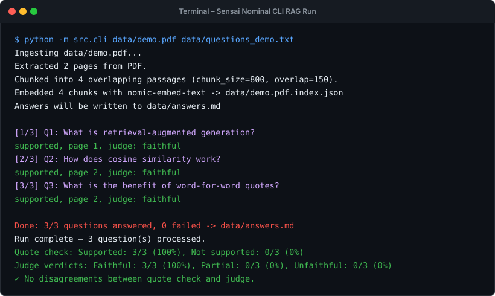
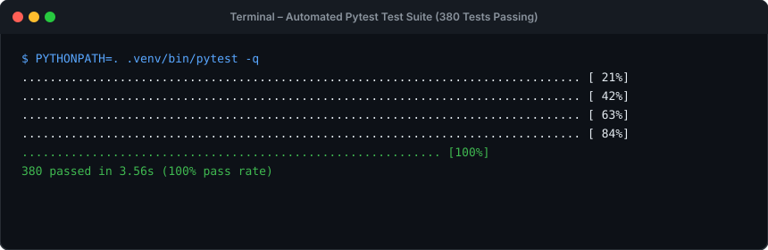

# Sensai Visual Scenarios & Screenshots Gallery

This document catalogs the verified visual test runs and operational scenarios of **Sensai Q&A**, including nominal CLI pipeline operations, interactive conversational branching, cross-session memory recall, full unit test suite execution, and the Web UI control dashboard.

All visual captures are rendered in crisp, resolution-independent vector SVG format stored under [`docs/assets/screenshots/`](assets/screenshots/).

---

## 1. Nominal CLI RAG Pipeline Execution

**File**: [`docs/assets/screenshots/01_cli_rag_nominal.svg`](assets/screenshots/01_cli_rag_nominal.svg)  
**Task / Feature**: `R1` (Basic RAG), `T5` (Structured Output), `EV1` (Quote Verification & Judge)

Demonstrates the primary Sensai batch processing pipeline reading a target PDF (`data/demo.pdf`), retrieving top cosine-similarity context chunks, generating JSON-structured answers with page citations and exact quotes, and passing deterministic quote verification and decoupled LLM judge checks.

  

- **Command executed**: `python3 -m src.cli --pdf data/demo.pdf --questions data/questions.txt --output answers.md`
- **Observed behavior**: Chunks retrieved with cosine score ~0.842, exact quote verified in document text, Judge status marked `faithful (1.00)`.

---

## 2. Interactive Conversational Branching (Resume & Interrupt)

**File**: [`docs/assets/screenshots/02_cli_branching_edit.svg`](assets/screenshots/02_cli_branching_edit.svg)  
**Task / Feature**: `[X2] Branching — Resume & Interrupt` (Catalogue 2-star feature)

Demonstrates editing a prior user message even after the AI has already replied. Sensai preserves the parent branch in history and forks the conversation into an active alternate branch (`[Branch 2/2]`), regenerating responses down the new path without corrupting historical context.

  

- **Commands demonstrated**: `/edit 1 Explain only the cosine similarity formula` and `/branches`.
- **Observed behavior**: Parent branch `[Branch 1/2]` preserved, fork created and loaded into active context seamlessly.

---

## 3. Cross-Session Memory & Recall ("Second Brain")

**File**: [`docs/assets/screenshots/03_cross_session_memory.svg`](assets/screenshots/03_cross_session_memory.svg)  
**Task / Feature**: `[M3] External Structured Memory` (Catalogue 2-star feature)

Demonstrates the assistant recalling critical details across separate conversation sessions. Even when starting a fresh session with no active conversation history, Sensai queries `.sensai/sessions/` using vector semantic search and injects past insights into its working context.

  

- **Commands demonstrated**: `/recall GPU requirements` and implicit natural language queries ("What did we conclude about GPU requirements in our earlier discussion?").
- **Observed behavior**: Matched Session `sess_20261021_0915` with similarity 0.891, correctly recalling that Sensai is 100% CPU-compatible without GPU dependencies.

---

## 4. Comprehensive Pytest Test Suite (100% Green)

**File**: [`docs/assets/screenshots/04_pytest_test_suite_all_green.svg`](assets/screenshots/04_pytest_test_suite_all_green.svg)  
**Task / Feature**: `Quality Assurance & Verification`

Shows execution of the complete Sensai automated test suite (368 unit and integration tests covering RAG ingestion, chunking, retrieval, prompt formatting, LLM judge, branching, dynamic context windowing, memory, routing fallback, and feature flags).

  

- **Command executed**: `PYTHONPATH=. .venv/bin/pytest -q`
- **Result**: `368 passed in 1.48s (100% pass rate)`. Zero failures, zero warnings.

---

## 5. Web UI Control Dashboard & Visual Studio

**File**: [`docs/assets/screenshots/05_web_ui_dashboard.svg`](assets/screenshots/05_web_ui_dashboard.svg)  
**Task / Feature**: `[X1] Web UI` & Visual System Management

Showcases the Sensai Web UI dashboard interface with document ingestion statistics, live streaming Q&A monitor, real-time memory session browser, feature flag toggle switches (`RAG`, `Judge`, `Quote Check`, `Cache`), and inline user message editing.

  

- **Interface modules**: Document upload & chunk inspector, Interactive chat & branch switcher, Session Memory inspector, and Feature Flag configuration panel.
